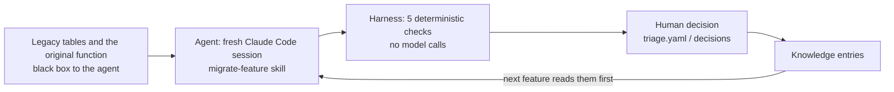

# Like for like

One feature, migrated by an agent and proven by a harness.

A small public demo of one idea: **an agent rebuilds and migrates a feature, a deterministic
harness proves the result matches the original, and a human decides what each difference
means.** The first feature is a timesheet (paid hours and gross pay per shift) that lives in
low-code-style tables; the second, clock-events, pairs time-clock events into paid shifts. The
target is a multi-tenant PostgreSQL model with row-level security.

- **Synthetic data.** Every tenant, person and number is generated from a fixed seed.
- **Real run output.** The page in `site/dist/index.html` is built from the files the runs wrote
  (`runs/**`, `knowledge/**`, `features/`); nothing on it is typed in by hand.
- **Tenant token is a local stand-in for Cognito.** Tokens have the claim shape of an Amazon
  Cognito ID token (`sub`, `custom:tenant_id`, `cognito:groups`) but are signed with a key
  generated on the spot. There is no Cognito here.

## The loop



What happened in this repository:

- **timesheet** (`runs/001`, `runs/002`): a fresh session that could not read the legacy logic got
  it right first time; the harness found no difference in 914 records, and the page says so. Its
  open questions were decided (`runs/001/decisions.md`) and became knowledge entries.
- **clock-events** (`runs/003`, `runs/004`): a second fresh session started from those entries.
  Its first run found differences on 10 pairs: legacy drops seconds before computing, and legacy
  reads a repeated local time (clocks going back) as the later instant, against an entry from the
  first feature. Each group was triaged in `harness/triage.yaml`; the agent reproduced the first
  (`legacy-bug-keep`), the second was accepted pending the product owner, and `runs/004` passed.
- `runs/seeded/` holds a run of the harness against a deliberately wrong calculation, labelled as
  seeded, to show the harness catches an error.

Decisions in this demo were made by the builder session on behalf of the owner, and say so.

## Run it

Requires Node 20+ and Docker.

```
npm ci
npm run db:up
npm run demo
```

`npm run demo` resets the database, seeds the legacy data, runs both migrations and runs the
harness for each feature (five checks each; exit code 0 means no unexplained difference).
Other commands: `npm test`, `npm run typecheck`, `npm run harness:seeded`, `npm run site:build`.

## How the agent was kept honest

The migration session is started with `npm run agent:migrate`, which loads
`.claude/migration-settings.json` only for that session:

- permission deny rules on the legacy logic, the seed script, the design notes, the seeded-fault
  code and everything the harness trusts;
- a PreToolUse hook (`.claude/hooks/guard.mjs`) as a second line, since deny rules are best-effort;
- the trust base made read-only at the OS level for the length of the session;
- afterwards, `audit/audit-session.ts` reads the session and subagent transcripts and fails if any
  tool result contains text that exists only in a denied file. The result is in `runs/<nnn>/meta.json`.

This is defence in depth, not a sandbox: the agent's own code runs under the same user account.
The honesty claim rests on the transcript audit.

## Layout

| Path | What |
|---|---|
| `legacy/` | Low-code-style tables, deterministic seed, the original function (`legacy/logic/`) |
| `platform/` | Target schema with RLS, `withTenant`, stand-in tokens, a reference example |
| `features/<name>/` | Each feature's brief, and everything the agent wrote |
| `harness/` | The five checks, `triage.yaml`, the seeded-fault check |
| `knowledge/` | Lessons written after the human decision |
| `runs/` | Reports, run notes, meta and decisions of each run |
| `site/` | Template and build for the page |
| `docs/DESIGN_AND_PLAN.md` | The design brief this was built from |

## Not in scope

No hosted backend, no live database behind the page, no real Cognito, no NestJS or Next.js app,
no infrastructure code, no custom agent loop (the agent is Claude Code), and two small features.
