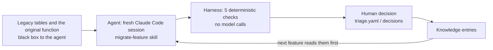

# Like for like

One feature, migrated by an agent and proven by a harness.

A small public demo of one idea: **an agent rebuilds and migrates one feature, a deterministic
harness proves the result matches the original, and a human decides what each difference
means.** The feature is a timesheet (paid hours and gross pay per shift) that lives in
low-code-style tables; the target is a multi-tenant PostgreSQL model with row-level security.

- **Synthetic data.** Every tenant, person and number is generated from a fixed seed.
- **Real run output.** The page in `site/dist/index.html` is built from the files the runs wrote
  (`runs/**`, `knowledge/**`, `features/timesheet/`); nothing on it is typed in by hand.
- **Tenant token is a local stand-in for Cognito.** Tokens have the claim shape of an Amazon
  Cognito ID token (`sub`, `custom:tenant_id`, `cognito:groups`) but are signed with a key
  generated on the spot. There is no Cognito here.

## The loop



What happened in this repository: the agent migrated the feature in a fresh session that could not
read the legacy logic (`runs/001`). The harness found **no** difference in 914 records, so the page
says so. The agent's open questions were decided (`runs/001/decisions.md`), the agent applied them
and wrote five knowledge entries, and `runs/002` passed again. To show the harness does catch an
error, `runs/seeded/` holds a run against a deliberately wrong calculation, labelled as seeded.

## Run it

Requires Node 20+ and Docker.

```
npm ci
npm run db:up
npm run demo
```

`npm run demo` resets the database, seeds the legacy data, runs the migration in
`features/timesheet/` and runs the harness (all five checks; exit code 0 means no unexplained
difference). Other commands: `npm test`, `npm run typecheck`, `npm run harness:seeded`,
`npm run site:build`.

## How the agent was kept honest

The migration session is started with `npm run agent:migrate`, which loads
`.claude/migration-settings.json` only for that session:

- permission deny rules on the legacy logic, the seed script, the design notes, the seeded-fault
  code and everything the harness trusts;
- a PreToolUse hook (`.claude/hooks/guard.mjs`) as a second line, since deny rules are best-effort;
- the trust base made read-only at the OS level for the length of the session;
- afterwards, `audit/audit-session.ts` reads the session and subagent transcripts and fails if any
  tool result contains text that exists only in a denied file. The result is in `runs/<nnn>/meta.json`.

This is defence in depth, not a sandbox: the agent's own code runs under the same user account.
The honesty claim rests on the transcript audit.

## Layout

| Path | What |
|---|---|
| `legacy/` | Low-code-style tables, deterministic seed, the original function (`legacy/logic/`) |
| `platform/` | Target schema with RLS, `withTenant`, stand-in tokens, a reference example |
| `features/timesheet/` | The brief, and everything the agent wrote |
| `harness/` | The five checks, `triage.yaml`, the seeded-fault check |
| `knowledge/` | Lessons written after the human decision |
| `runs/` | Reports, run notes, meta and decisions of each run |
| `site/` | Template and build for the page |
| `docs/DESIGN_AND_PLAN.md` | The design brief this was built from |

## Not in scope

No hosted backend, no live database behind the page, no real Cognito, no NestJS or Next.js app,
no infrastructure code, no custom agent loop (the agent is Claude Code), and one feature only.
